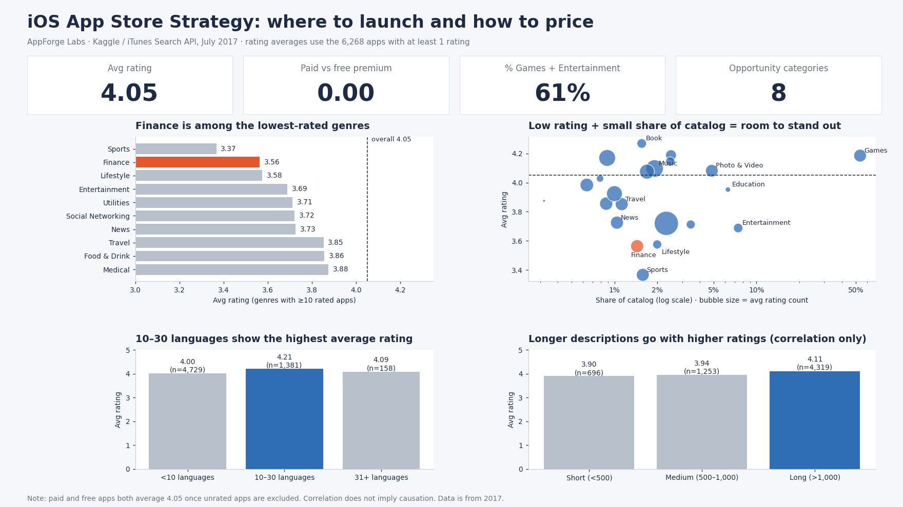

# AppForge Labs – iOS App Strategy Analysis

> **Recommendation in one line:** Enter Finance with a quality-first app, keep localization within 10–30 languages, write detailed descriptions, and do not count on a paid price to lift ratings.

**Role:** Data Analyst, Product Strategy · **Tools:** SQL (SQLite), Python (charts) · **Data:** Apple App Store snapshot, July 2017

> **Note:** This is a portfolio project. AppForge Labs is a fictional company, and the data is a public Kaggle dataset.

.

---

## 1. Business Context

AppForge Labs advises indie developers and startups launching on the App Store.
**Stakeholder:** Head of Product Strategy.

**Questions to answer**
1. Which categories offer the best opportunity (low saturation, low ratings)?
2. How should new apps be priced?
3. What actually drives higher ratings?

## 2. North Star Metrics

| Metric | Definition | Result |
|---|---|---|
| Average User Rating | Mean `user_rating`, rated apps only | 4.05 |
| Rating Volume | Mean `rating_count_tot`, a proxy for demand and reach | 14,804 per app (median 512.5) |
| Paid vs Free Rating Premium | Avg rating (paid) − avg rating (free) | 0.00 (4.05 vs 4.05) |
| Category Opportunity | Genre with ≥10 rated apps, avg rating below overall, and share of catalog below the median genre | 8 genres; strongest case: Finance |

**Dimensions:** price type (paid/free), genre, language count, description length.

## 3. Data

| | |
|---|---|
| Source | [Kaggle – Mobile App Store (7200 apps)](https://www.kaggle.com/datasets/ramamet4/app-store-apple-data-set-10k-apps) |
| Origin | iTunes Search API, collected July 2017 |
| Size | 7,197 apps (`AppleStore.csv`, 16 columns plus an unnamed index column) and 7,197 descriptions (`appleStore_description.csv`) |
| Grain | One row per app (`id`); all ids are unique in both files |
| Key columns | `price`, `user_rating`, `rating_count_tot`, `prime_genre`, `lang.num`, `app_desc` |
| License | GPL 2 |

**Cleaning decisions** (full log in `docs/provenance.md`)
- Raw files were kept untouched; all work was done on copies.
- **929 apps (12.9%) have no ratings.** Their `user_rating` is 0, which is not a real rating, so they are excluded from rating averages. This leaves 6,268 rated apps. They are kept for share-of-catalog counts.
- The unnamed index column is ignored.
- `lang.num` contains a dot, so it is quoted in SQL (`"lang.num"`).

## 4. Executive Summary

1. **Paid apps do not rate higher than free apps.** Both average 4.05. The raw gap (3.72 vs 3.38) comes from unrated apps: 16.6% of free apps have no ratings, versus 8.2% of paid apps.
2. **10–30 languages is the best bucket:** 4.21, against 4.09 for 31+ and 4.00 for fewer than 10.
3. **Finance is the clearest opening:** avg rating 3.56 versus 4.05 overall, only 1.4% of the catalog, and healthy rating volume (16,182 per app).
4. **Games and Entertainment hold 61% of the catalog,** but Games rate high (4.19), so the case against Games is saturation, not quality.
5. **Longer descriptions go with higher ratings** (4.11 for >1,000 characters versus 3.90 under 500), but the relationship is weak.

## 5. Key Insights

### Category Opportunity
- **What:** Sports (3.37), Finance (3.56) and Lifestyle (3.58) have the lowest ratings. Finance has 104 apps (1.4% of the catalog) and strong rating volume. Books rate highest of all (4.27), and Catalogs has only 10 apps (5 rated), too few to conclude.
- **Why (hypothesis):** Finance users have high expectations (trust, accuracy, security) that many apps fail to meet.
- **So what:** A well-executed Finance app can stand out against weak competition in a category with real demand.
- **Now what:** Prioritize Finance. Validate against Sports and Lifestyle before committing.

### Pricing
- **What:** Paid and free apps both average 4.05 (n = 2,885 and 3,383, p = 0.89). Paid apps collect far fewer ratings (median 259 versus 1,033).
- **Why (hypothesis):** Free apps are downloaded by more casual users, so many never leave a rating, which inflated the paid "premium" in the raw data. Fewer ratings also reduce social proof for paid apps.
- **So what:** Price is not a lever for ratings. It does affect how many ratings an app collects.
- **Now what:** Choose pricing on revenue and ratings volume, not on expected rating. Inside Finance, paid apps look better (4.16 vs 3.39), but only 16 paid apps exist, so test it before relying on it.

### Languages
- **What:** Apps with 10–30 languages average 4.21, versus 4.09 for 31+ (n = 158) and 4.00 for fewer than 10.
- **Why (hypothesis):** Apps with more languages are larger and more established (median 1,701 ratings for 10–30, versus 336 for fewer than 10), so language count may reflect maturity, not cause quality.
- **So what:** There is no evidence that localizing beyond 30 languages improves ratings.
- **Now what:** Localize to the main target markets, within 10–30 languages, and treat more as optional.

### Description Length
- **What:** Long descriptions (>1,000 characters) average 4.11, versus 3.94 for medium and 3.90 for short. The correlation is weak (0.08).
- **Why (hypothesis):** Clearer value propositions set expectations and reduce disappointment, or better teams write longer descriptions.
- **So what:** It is a lever the team controls before launch, but it is correlation, not proven causation.
- **Now what:** Require detailed, benefit-focused copy and A/B test it.

## 6. Recommendations

| # | Action | Owner | Expected impact | Metric to track |
|---|---|---|---|---|
| 1 | Launch a quality-first app in Finance | Product Strategy + clients' PMs | Rating above the Finance average (3.56) in a low-saturation category | Avg rating vs 3.56 after 90 days |
| 2 | Decide pricing on revenue, not on rating | Pricing / Business lead | Avoid assuming a rating premium that does not exist | Ratings collected in the first 90 days |
| 3 | Keep localization within 10–30 languages | Localization lead | Lower cost, no rating loss | Rating and cost per added language |
| 4 | Require long, benefit-focused descriptions and A/B test them | Marketing / ASO | Possible rating lift | Avg rating vs baseline |
| 5 | Avoid pure Games without clear expertise | Head of Product Strategy | Better resource allocation | Share of portfolio in Games |

## 7. Limitations

- **Old data:** the snapshot is from July 2017, so findings are directional, not current.
- **Correlation ≠ causation:** especially for description length and language count.
- **Unrated apps:** 12.9% of apps are excluded from rating averages, which changes some conclusions (see Pricing).
- **Missing business data:** no downloads, revenue or retention. Rating is a proxy for quality, not for commercial success.
- **Small groups:** paid Finance apps (n = 16), the 31+ language bucket (n = 158) and Catalogs (10 apps) are too small for firm conclusions.
- **Low rating ≠ opportunity by itself:** it may also reflect a hard category, which is why rating volume is checked next to it.

## 8. Repository Structure

```text
AppForge-iOS-Strategy/
├── README.md
├── docs/              # provenance, cleaning log and dashboard image
└── sql/               # analysis queries
```
